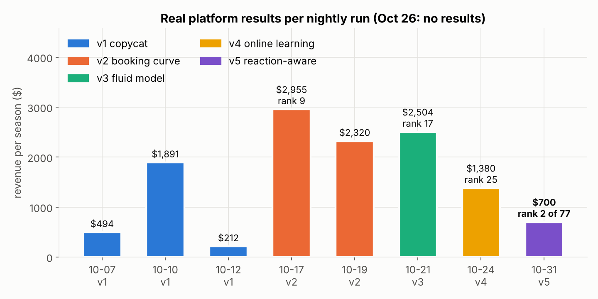
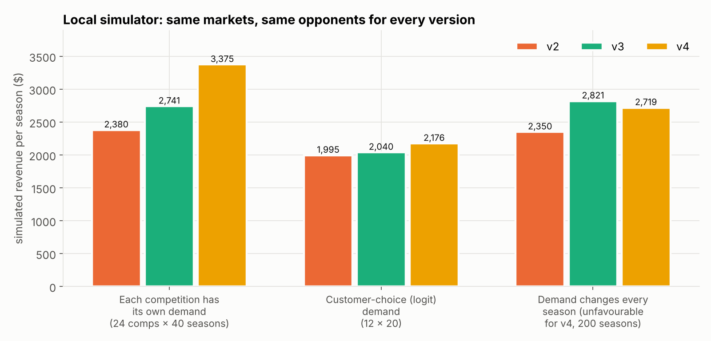
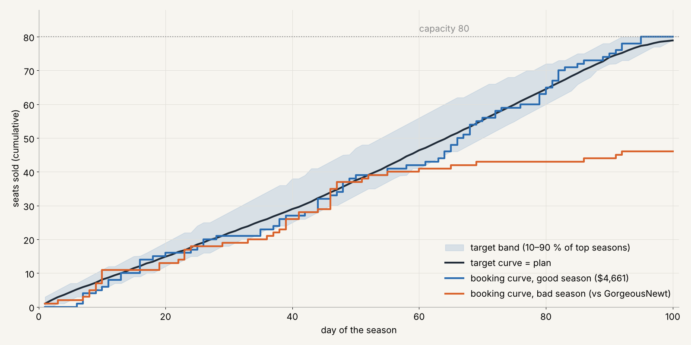
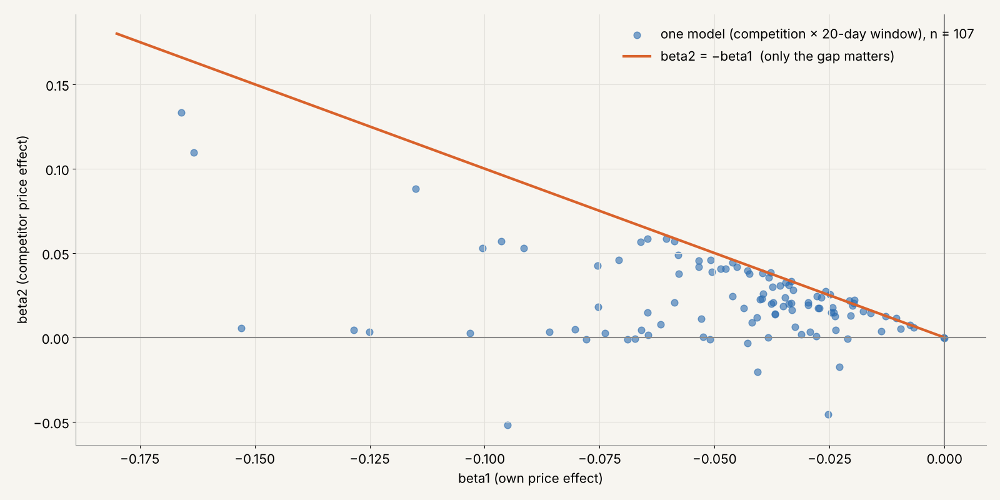
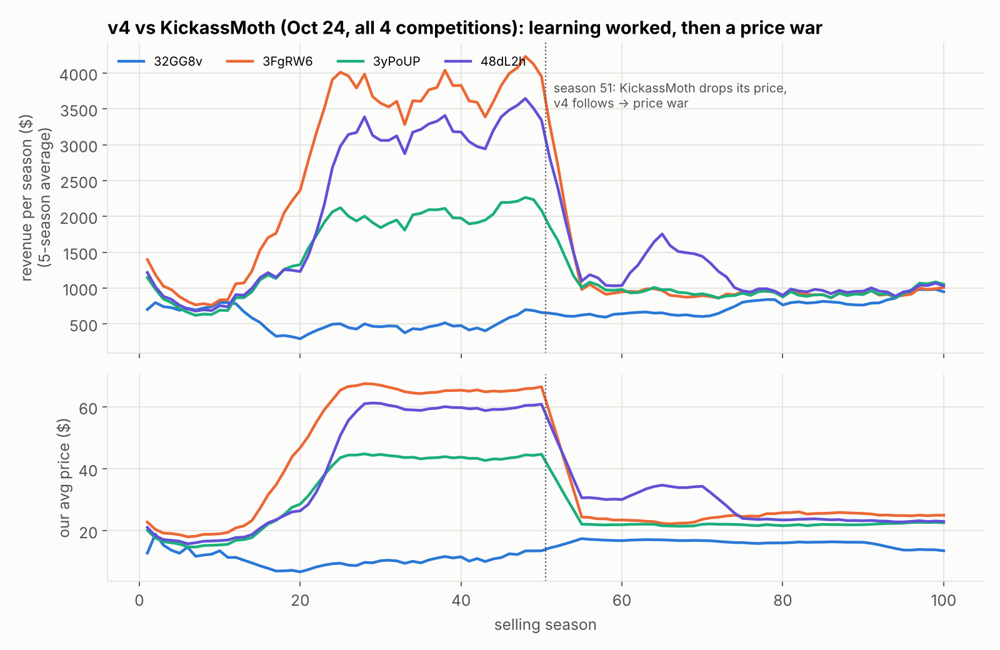

# Dynamic Pricing Competition: from copycat to rank 2 of 77

Five versions of a pricing algorithm I built for the **Dynamic Pricing Competition (DPC)** in the Learning & Optimisation module at BHT Berlin (winter semester 2026/27). I competed alone, as team *BenevolentSwan*.

**The game:** two airlines sell the same flight. Each has 80 seats and 100 days to sell them. Every day each sets one price, and customers buy from one of them or not at all. A competition runs 100 seasons against the same rival in the same market. The demand model is secret and different in every competition, and the rivals are other students' algorithms, updated several times a week. The whole algorithm is one function, `p(...)`, which gets the day, both price histories, my sales so far and whether the rival still has seats, and returns today's price.



## The five versions

| Version | Idea | Real result | What I learned |
|---|---|---|---|
| [v1 copycat](algorithms/v1_copycat_template/duopoly.py) | Course template: copy the rival's last price | $212 – $1,891 per season | The rival decides everything. Copied prices also make the data useless for regression, because both price columns are identical |
| [v2 booking curve](algorithms/v2_booking_curve/duopoly.py) | Target curve of seats sold per day (average of my best 20% of seasons). Behind plan: undercut. Ahead: mark up | $2,955 per season, **rank 9** | Pacing works: 8 of 12 competitions sold out. But fixed rules (for example a $55 "monopoly" price) fail in cheap markets |
| [v3 fluid model](algorithms/v3_fluid_model/duopoly.py) | Poisson demand model fitted on 270k past periods. Each day: price = argmax of price × min(seats left, predicted sales) | $2,504, rank 17 | One pooled model can't fit every market. The price where elasticity = 1 ranged from $3.90 to $42.70 across 34 competitions |
| [v4 online learning](algorithms/v4_online_learning/duopoly.py) | Learns market size and price sensitivity per competition while playing (MAP Poisson regression, Newton's method, prior from past runs) | $1,380, rank 25 | It learned the market, but assumed the rival's price is fixed. The rival followed my price down, and both ended in a price war |
| [v5 reaction-aware](algorithms/v5_reaction_aware/duopoly.py) | v4 + learns the "cheaper bonus" + a least-squares model of the rival: his price today vs my price yesterday. If he follows me, undercutting is pointless, so it picks the best price level instead | **Rank 2 of 77** (31 Oct 2026) | Modelling the opponent matters as much as modelling the customers |

Each of v3–v5 has a `NOTES.md` with the reasoning, simulator results and known limitations. Before each upload I tested the new version in my own simulator, on the same markets and opponents as the old ones:



## Two methods carry the story

**1. Booking curve: am I on pace?** The target curve says how many seats I should have sold by each day. The booking curve is what I really sold. The gap between them drives the price, like a thermostat.



**2. Demand regression: how do buyers react to price?** I fitted demand = β0 + β1·own price + β2·rival price per competition and per 20-day window: 107 models. Every model has β1 < 0 and 89% have β2 > 0. Many lie on β2 ≈ −β1, so mostly **the price gap matters, not the level**. β1 ranges from about −0.01 to −0.17, so every market is different.



In one sentence: **the curve checks the pace, the regression sets the price.**

## The price war (v4) and the fix (v5)

From season 51 the rival cut his price. v4 followed him down, because it assumed his price was fixed and always tried to be slightly cheaper. The correlation between his price today and mine yesterday was 0.91, and the same in reverse.



v5 fits comp_t = α + β·my_{t−1} + γ·comp_{t−1}. If the rival is a follower, it predicts where his price will move for every candidate price of mine, and chooses the best level instead of undercutting. In my simulator with reacting opponents (25 competitions × 60 seasons), v5 made $2,270 per season vs $2,133 for v4 and $1,927 for v2.

## Honest limitations

- Rank 2 of 77 was one nightly run with low demand for everyone: nobody in the top 10 sold out, so revenue per season was low across the board. The rank compares all teams in the same markets.
- My simulator uses the same model family as v3–v5, so it is optimistic for them. I learned this when v3 looked safe locally and then got stuck in extreme markets.
- Next (v6): use the booking-curve band as an alarm to trigger re-fitting, add a price floor in low-demand markets, and run walk-forward tests before every upload.

## Files

```
algorithms/
  v1_copycat_template/   course template (not my design)
  v2_booking_curve/
  v3_fluid_model/        + NOTES.md
  v4_online_learning/    + NOTES.md
  v5_reaction_aware/     + NOTES.md
charts/                  figures from my analysis and presentation
report/DPC_Report_short.pdf   two-page summary
```

Run any version by importing `p` from its `duopoly.py` (needs `numpy`, and `pandas` for v1).

Methods: booking curves and capacity utilisation, price elasticity and the capacity rule (Phillips, *Pricing and Revenue Optimization*, ch. 3), OLS and Poisson regression, Newton's method, grid search, a simple leader/follower response.
